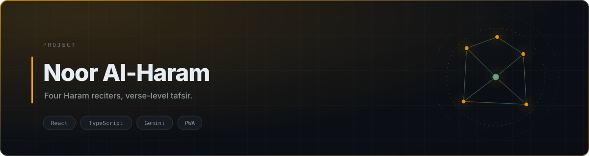
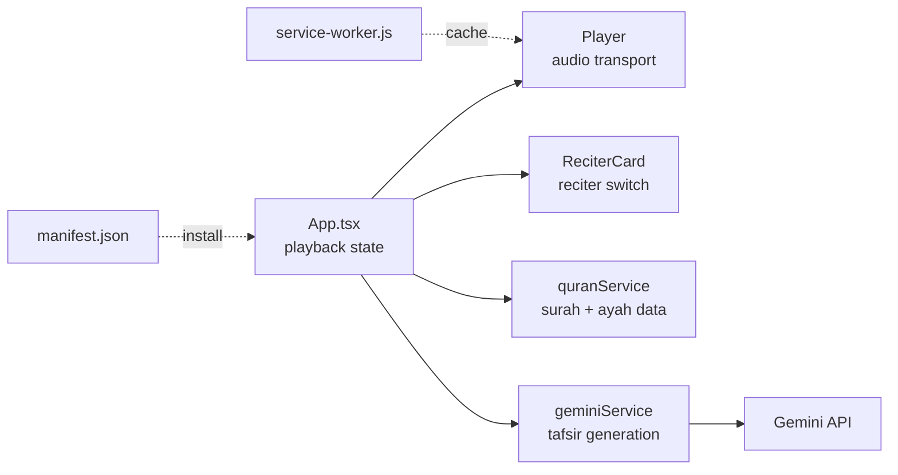

<div align="center">

<picture>
  <source media="(prefers-color-scheme: dark)" srcset="./assets/banner-dark.svg">
  <source media="(prefers-color-scheme: light)" srcset="./assets/banner-light.svg">
  
</picture>

<br>


<br><br>

<a href="https://quran-theta-lyart.vercel.app"><b>Live Demo</b></a> · <a href="#quick-start">Quick Start</a> · <a href="#architecture">Architecture</a>

</div>

## Overview

Listening to the Quran is usually an all-or-nothing experience: pick a reciter, press play, lose your place. **Noor Al-Haram** makes it granular — choose one of four renowned reciters of the Haram, select the exact verse you want, and read AI-generated tafsir beside it.

It's built as a service-worker-backed PWA, so a surah you've opened stays available when the connection drops — which matters for a tool people use during travel and in low-signal environments.

## Key Features

| | |
|---|---|
| **Four Haram reciters** | Switch reciter without losing your position in the surah |
| **Verse-level selection** | Jump to and replay a single ayah instead of scrubbing a timeline |
| **AI tafsir** | Gemini generates commentary and keyword extraction scoped to the selected verse |
| **Offline listening** | A service worker caches opened content so playback survives a dropped connection |
| **Installable** | Manifest + icons, so it installs to a home screen like a native app |

## Architecture



Audio transport and reciter selection are separate components so switching reciter never tears down the player. `quranService` is the only module that knows the corpus shape; `geminiService` is the only module that makes model calls.

## Project Structure

```text
.
├── App.tsx                 # playback + selection state
├── components/
│   ├── Player.tsx          # audio transport, verse scrubbing
│   └── ReciterCard.tsx     # reciter identity + switch
├── services/
│   ├── geminiService.ts    # tafsir boundary
│   └── quranService.ts     # surah/ayah retrieval
├── constants.ts            # reciter metadata
├── types.ts                # shared contracts
├── manifest.json           # PWA manifest
└── service-worker.js       # offline cache strategy
```

## Quick Start

```bash
git clone https://github.com/tribetorkoz/noor-al-haram.git
cd noor-al-haram
npm install
cp .env.example .env      # add your GEMINI_API_KEY
npm run dev               # http://localhost:3000
```

<details>
<summary><b>Environment variables</b></summary>

| Variable | Required | Purpose |
|---|---|---|
| `GEMINI_API_KEY` | Yes | Generates tafsir and keyword extraction. Get one at [aistudio.google.com/apikey](https://aistudio.google.com/apikey) |
</details>

<details>
<summary><b>Build for production</b></summary>

```bash
npm run build
npm run preview
```

Deployed on Vercel. The service worker only registers on a production build.
</details>

## License

MIT
